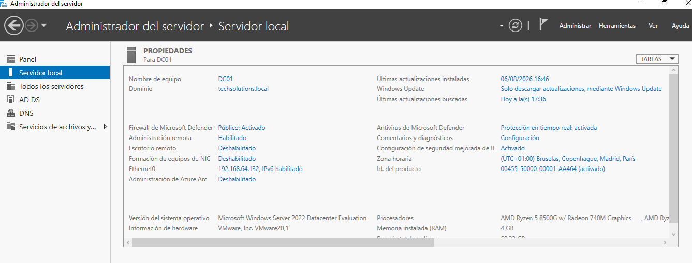
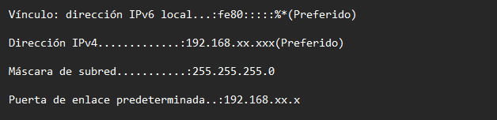
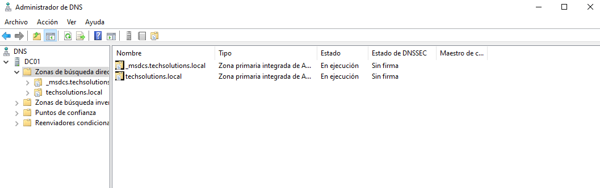
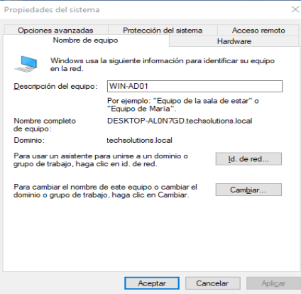

# 🏗️ Infraestructura del Laboratorio

## 📌 Descripción

Esta sección documenta la infraestructura utilizada como base para la implementación del laboratorio de Active Directory e IAM de TechSolutions.

El entorno fue construido en una infraestructura virtualizada utilizando VMware, con el objetivo de simular una red empresarial pequeña y controlada para realizar pruebas de administración de sistemas, gestión de identidades, políticas de seguridad, permisos y auditoría.

---

## 🎯 Objetivo

El objetivo de esta fase fue preparar la infraestructura necesaria para implementar posteriormente:

- Active Directory Domain Services (AD DS)
- DNS
- Gestión de usuarios y grupos
- Group Policy
- Recursos compartidos
- Permisos NTFS
- Auditoría
- Automatización mediante PowerShell

---

# 🖥️ Componentes del laboratorio

| Equipo | Sistema Operativo | Función |
|---|---|---|
| DC01 | Windows Server 2022 Datacenter (Evaluation) — VMware, 4 GB de RAM | Controlador de dominio / DNS / GPO / File Server |
| Cliente Windows 10 | Windows 10 — VMware | Equipo cliente unido al dominio `techsolutions.local` |

---

# 🌐 Configuración de red

La infraestructura utiliza una red privada de laboratorio con máscara `255.255.255.0` (red `192.168.x.0/24`). Las direcciones IP se muestran parcialmente ocultas en las capturas.

---

# 📸 Evidencias

## 1. Controlador de dominio DC01

Administrador del servidor sobre `DC01`, ya unido al dominio `techsolutions.local`, con los roles **AD DS** y **DNS** y los servicios de archivos disponibles. Corre Windows Server 2022 Datacenter Evaluation sobre VMware, con Microsoft Defender Antivirus (protección en tiempo real) y Firewall de Microsoft Defender activos.

---

## 2. Configuración de red de DC01

Configuración IPv4 del adaptador de DC01: dirección, máscara `255.255.255.0` y puerta de enlace de la red privada del laboratorio.

---

## 3. Zona DNS

Consola de DNS en `DC01` con las zonas de búsqueda directa `techsolutions.local` y `_msdcs.techsolutions.local`, ambas **primarias integradas en Active Directory** y en ejecución. La presencia de `_msdcs` confirma que el dominio quedó correctamente registrado y que los clientes pueden localizar al controlador de dominio.

---

## 4. Cliente Windows 10 unido al dominio

Propiedades del sistema del cliente Windows 10: el campo **Dominio** muestra `techsolutions.local`, es decir, el equipo quedó unido al dominio.

---

## 🚀 Siguiente paso

Con el dominio y el DNS funcionando, se construyó la estructura de OUs, usuarios y grupos — ver [`02-Active-Directory`](../02-Active-Directory/).
