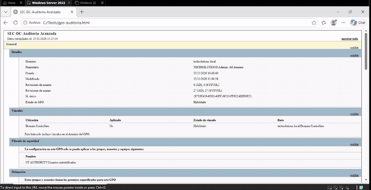

# 📜 Detalle de políticas

> Reconstruido desde cero verificando cada GPO directo en la consola. Se documenta GPO por GPO a medida que se confirma.

**Inventario de partida** (5 GPOs en el dominio, confirmado en [`Evidencias/00-Inventario-GPOs.png`](Evidencias/00-Inventario-GPOs.png)): `Default Domain Controllers Policy` (fuera de alcance, sin configuración custom), `Default Domain Policy` (secciones 3 y 4), `GPO - Windows10 - Banner Legal` (sección 1), `GPO_Auditoria_Objetos` (fuera de alcance — ver [`06-Auditoria`](../06-Auditoria/)), `GPO_Restriccion_Ventas` (sección 2).

---

## 1️⃣ Banner legal de inicio de sesión

**GPO:** `GPO - Windows10 - Banner Legal`

**Ámbito (vínculos):**

| Ubicación | Exigido | Vínculo habilitado | Ruta |
|---|---|---|---|
| Windows10 | No | Sí | `techsolutions.local/TechSolutions/09_Equipos/Windows10` |

**Filtrado de seguridad:** Usuarios autentificados.

**Configuración** — Configuración del equipo → Directivas → Configuración de Windows → Configuración de seguridad → Directivas locales/Opciones de seguridad → Inicio de sesión interactivo:

| Directiva | Configuración |
|---|---|
| Título del mensaje | `Bienvenido a TechSolutions S.A.` |
| Texto del mensaje | Este equipo es propiedad de TechSolutions S.A. El acceso está permitido únicamente a personal autorizado. Toda actividad realizada en este equipo puede ser registrada, supervisada y auditada conforme a las políticas de seguridad de la organización. Si usted no está autorizado, cierre esta sesión inmediatamente. |

**Alcance real:** aplica a los equipos cliente Windows 10 dentro de `09_Equipos/Windows10` (no está vinculada en la raíz del dominio).

**Evidencia:** [`Evidencias/01-Banner-Legal-Ambito.png`](Evidencias/01-Banner-Legal-Ambito.png), [`Evidencias/02-Banner-Legal-Configuracion.png`](Evidencias/02-Banner-Legal-Configuracion.png).

---

## 2️⃣ Restricción por departamento (ejemplo: Ventas)

**GPO:** `GPO_Restriccion_Ventas`

**Ámbito (vínculos):**

| Ubicación | Exigido | Vínculo habilitado | Ruta |
|---|---|---|---|
| 07_Ventas | No | Sí | `techsolutions.local/TechSolutions/07_Ventas` |

**Filtrado de seguridad:** Usuarios autentificados.

**Configuración:**

| Ámbito | Configuración |
|---|---|
| Configuración del equipo | No definida |
| Configuración del usuario → Plantillas administrativas → Panel de control → *"Prohibir el acceso a Configuración de PC y a Panel de control"* | Habilitado |

Es una directiva de **usuario**, no de equipo — viaja con la cuenta sin importar desde qué PC del dominio se loguee.

**Evidencia:** [`Evidencias/03-Restriccion-Ventas-Ambito.png`](Evidencias/03-Restriccion-Ventas-Ambito.png), [`Evidencias/04-Restriccion-Ventas-Configuracion.png`](Evidencias/04-Restriccion-Ventas-Configuracion.png).

## 3️⃣ Bloqueo de cuenta

**GPO:** `Default Domain Policy`

**Ámbito (vínculos):**

| Ubicación | Exigido | Vínculo habilitado | Ruta |
|---|---|---|---|
| techsolutions.local | No | Sí | `techsolutions.local` (raíz del dominio) |

**Filtrado de seguridad:** Usuarios autentificados.

**Configuración** — Configuración del equipo → Directivas de cuenta → Directiva de bloqueo de cuenta:

| Directiva | Configuración |
|---|---|
| Umbral de bloqueo de cuenta | 5 intentos de inicio de sesión no válidos |
| Duración del bloqueo de cuenta | 15 minutos |
| Restablecer recuentos de bloqueo de cuenta tras | 15 minutos |
| Permitir bloqueo de la cuenta del administrador | Habilitado |

Las directivas de cuenta (bloqueo, contraseñas) solo tienen efecto real si están definidas en una GPO vinculada en la **raíz del dominio** — por eso se configuró directamente sobre Default Domain Policy en vez de crear una GPO nueva vinculada a una OU.

La cuenta `Administrador` local queda sujeta a la misma directiva de bloqueo que cualquier otra cuenta — por defecto Windows la exime de bloqueo por intentos fallidos (para que un atacante no pueda dejar sin acceso administrativo al equipo bloqueándola a propósito). Acá se decidió habilitar la excepción a esa exención a propósito: la política aplica sin distinción de rango, y el riesgo de quedar sin acceso administrativo está mitigado porque no depende de esa única cuenta (existe `Admins. del dominio` y la delegación a `SG_Delegados_Helpdesk`).

**Evidencia:** [`Evidencias/05-Vinculo-Default-Domain-Policy.png`](Evidencias/05-Vinculo-Default-Domain-Policy.png), [`Evidencias/06-Bloqueo-Cuenta-15min.png`](Evidencias/06-Bloqueo-Cuenta-15min.png).

## 4️⃣ Bloqueo de pantalla por inactividad

**GPO:** `Default Domain Policy`

**Configuración** — Configuración del equipo → Directivas locales/Opciones de seguridad → Otro:

| Directiva | Configuración |
|---|---|
| Inicio de sesión interactivo: límite de inactividad del equipo | 600 segundos (10 minutos) |

**Vínculo:** raíz del dominio (`techsolutions.local`) — ver Ámbito en la sección 3, misma GPO. **Alcance:** todo el dominio, incluido el DC.

**Evidencia:** [`Evidencias/07-Limite-Inactividad-600s.png`](Evidencias/07-Limite-Inactividad-600s.png).


---

# 🛡️ GPOs y políticas de seguridad de la fase de hardening

Se agregaron después de la auditoría con PingCastle (ver [`11-Hardening-PingCastle`](../11-Hardening-PingCastle/)).

## 5️⃣ `SEC-DC-Auditoria-Avanzada`

**Vínculo:** OU `Domain Controllers`.

| Ajuste | Valor |
|---|---|
| Advanced Audit Policy | 32 subcategorías habilitadas (Kerberos, Logon/Logoff, Account Lockout, Directory Service, Account Management, etc.) |
| Tamaño del log Security | 512 MB |
| Auditoría de línea de comandos en creación de procesos (4688) | Habilitada |



Además se configuró una **SACL en la raíz del dominio** para auditar los derechos extendidos de replicación (evento 4662).

## 6️⃣ `SEC-Dominio-Hardening`

**Vínculo:** raíz del dominio.

| Ajuste | Valor | Por qué |
|---|---|---|
| UNC Hardened Paths (SYSVOL / NETLOGON) | Autenticación mutua + integridad | Evita MITM sobre rutas de GPO |
| Nivel de autenticación LAN Manager | 5 (solo NTLMv2) | Elimina LM y NTLMv1 |
| LLMNR (`EnableMulticast`) | 0 | Resolución de respaldo innecesaria con DNS correcto |
| mDNS (`EnableMDNS`) | 0 | Ídem |
| NetBIOS sobre TCP/IP (NBT-NS) | Deshabilitado | Ídem |

```powershell
Set-GPRegistryValue -Name "SEC-Dominio-Hardening" -Key "HKLM\SOFTWARE\Policies\Microsoft\Windows NT\DNSClient" -ValueName EnableMulticast -Type DWord -Value 0
Set-GPRegistryValue -Name "SEC-Dominio-Hardening" -Key "HKLM\SYSTEM\CurrentControlSet\Services\Dnscache\Parameters" -ValueName EnableMDNS -Type DWord -Value 0
```

**Evidencia:** [`Evidencias/08-GPO-SEC-DC-Auditoria-Avanzada.gif`](Evidencias/08-GPO-SEC-DC-Auditoria-Avanzada.gif) (informe HTML de la GPO) y capturas en [`11-Hardening-PingCastle/Evidencias`](../11-Hardening-PingCastle/Evidencias/).

## 7️⃣ `SEC-LAPS-Estaciones`

**Vínculo:** OU `Windows10` (dentro de `09_Equipos`). Windows LAPS con almacenamiento en Active Directory.

| Ajuste | Valor |
|---|---|
| `BackupDirectory` | 2 (Active Directory) |
| `PasswordAgeDays` | 30 |
| `PasswordLength` | 20 |
| `PasswordComplexity` | 4 |

Preparación: `Update-LapsADSchema` (con membresía temporal en Schema Admins, luego removida) y `Set-LapsADComputerSelfPermission` sobre la OU. Lectura autorizada: `Get-LapsADPassword -Identity <equipo> -AsPlainText`.

## 8️⃣ Fine-Grained Password Policy `PSO-Cuentas-Servicio`

Aplica al grupo `SG-Cuentas-Servicio`.

| Parámetro | Valor |
|---|---|
| Longitud mínima | 25 |
| Complejidad | Habilitada |
| Historial | 24 |
| Edad mínima / máxima | 1 día / 365 días |
| Bloqueo | 5 intentos, 15 min, ventana de 15 min |

```powershell
New-ADFineGrainedPasswordPolicy -Name "PSO-Cuentas-Servicio" -Precedence 10 -MinPasswordLength 25 -ComplexityEnabled $true -PasswordHistoryCount 24 -MinPasswordAge "1.00:00:00" -MaxPasswordAge "365.00:00:00" -LockoutThreshold 5 -LockoutDuration "00:15:00" -LockoutObservationWindow "00:15:00" -ReversibleEncryptionEnabled $false
Add-ADFineGrainedPasswordPolicySubject -Identity "PSO-Cuentas-Servicio" -Subjects "SG-Cuentas-Servicio"
```
