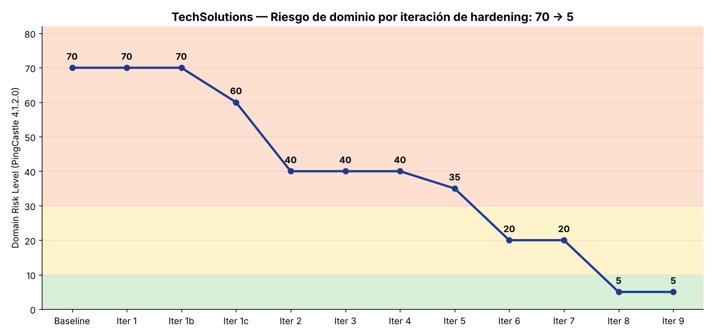
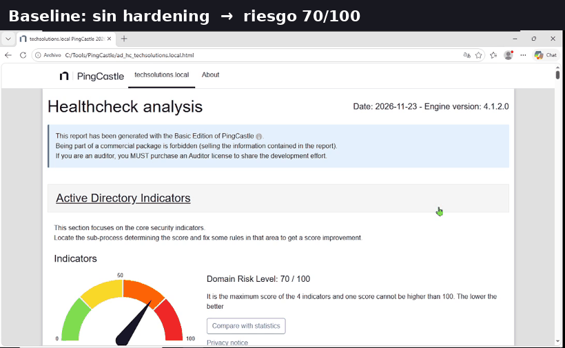
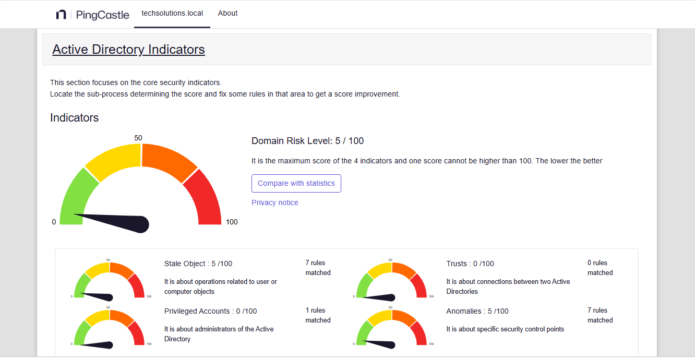
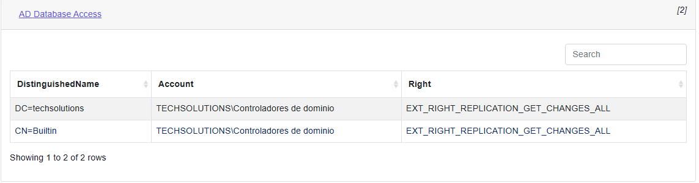

# 🛡️ 11 — Hardening con PingCastle

Auditoría de seguridad de `techsolutions.local` con **PingCastle 4.1.2.0** y una serie de iteraciones de hardening, midiendo el score después de cada cambio.

## 📈 Resultado

| Momento | Score global (Basic) |
|---|---|
| Baseline | **70** |
| Iteración 1 / 1b | 70 |
| Iteración 1c | 60 |
| Iteración 2 | 40 |
| Iteración 3 | 40 |
| Iteración 4 | 40 |
| Iteración 5 | 35 |
| Iteración 6 | 20 |
| Iteración 7 | 20 |
| Iteración 8 | 5 |
| Iteración 9 | 5 |
| Re-auditoría post-SIEM (10) | **5** |

> El score global de PingCastle es el **máximo** de cuatro indicadores (Stale Objects, Privileged Accounts, Trusts, Anomalies). Bajarlo exige cerrar el peor indicador, no mejorar el promedio.

## 🔁 Re-auditoría después de las pruebas con Wazuh

Después de [`13-Wazuh-SIEM`](../13-Wazuh-SIEM/) se repitieron cinco ataques contra el dominio, reproduciendo a propósito y por poco tiempo las malas configuraciones (preautenticación desactivada, permisos de replicación, RC4 en una cuenta de prueba). Todo se revirtió, y esta medición confirma que no quedó nada abierto:

| Indicador | Iteración 9 | Re-auditoría |
|---|---|---|
| Stale Objects | 5 | 5 |
| Privileged Accounts | 0 | 0 |
| Trusts | 0 | 0 |
| Anomalies | 5 | 5 |
| **Score** | **5** | **5** |

- **AD Database Access** (quién puede hacer DCSync): solo `Controladores de dominio`. La ACL que se le dio a `ptorres` para probar la regla `100221` no quedó.
- Los 5 puntos restantes son los dos límites ya documentados en [`pendientes.md`](pendientes.md): Windows 10 22H2 sin soporte (Stale Objects, regla `S-OS-W10`) y un único controlador de dominio (Anomalies).

## 🧭 Metodología

1. Ejecutar PingCastle (misma versión siempre) y guardar el informe de cada iteración.
2. Elegir los hallazgos de mayor impacto.
3. Aplicar el cambio y documentar el comando.
4. Volver a medir.

Detalle de cada iteración: [`iteraciones.md`](iteraciones.md). Lo que quedó sin cerrar y por qué: [`pendientes.md`](pendientes.md).

## 🗂️ Evidencias

Capturas y GIFs en [`Evidencias/`](Evidencias/) (ver [`Evidencias/README.md`](Evidencias/README.md)).
