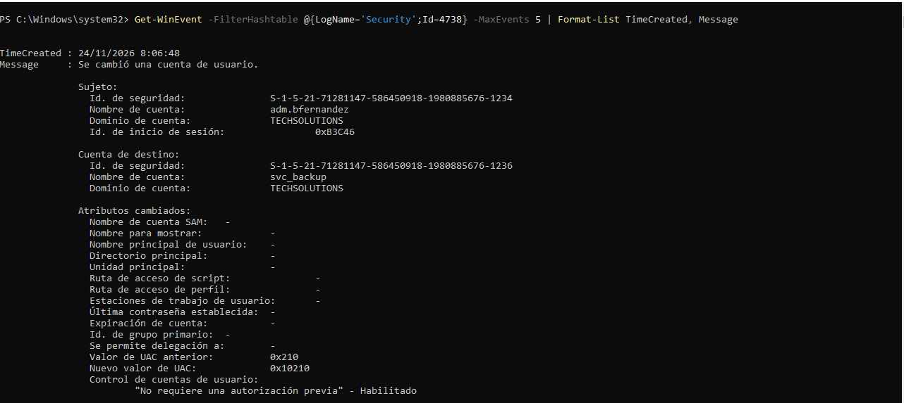
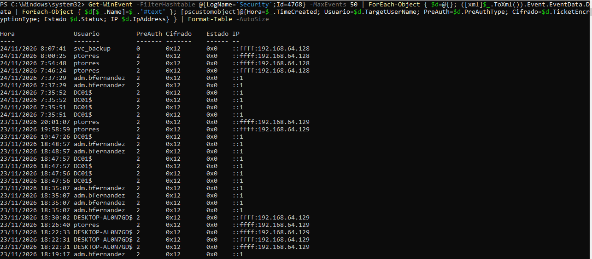
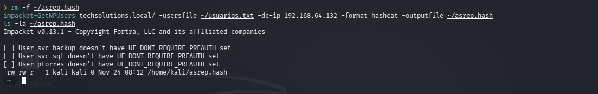

# 🎟️ Escenario 02 — AS-REP Roasting

**MITRE ATT&CK:** T1558.004 · **Cuenta objetivo:** `svc_backup` (con la preautenticación Kerberos deshabilitada a propósito)

## 📝 Qué se probó
Se habilitó el flag `DoesNotRequirePreAuth` en una cuenta de laboratorio y, desde Kali (impacket + hashcat modo 18200), se obtuvo material para ataque offline. La contraseña era débil y se recuperó.

## 🔍 Detección
- **4768** (TGT solicitado) con `PreAuthType = 0`: la cuenta respondió sin preautenticación.
- **4738** (cuenta modificada) cuando alguien cambia el flag en la cuenta: es la alerta *previa* al ataque.

> Aclaración importante: en el 4768 el cifrado del TGT puede verse como `0x12`. El indicador es `PreAuthType 0`, no el tipo de cifrado.

```powershell
Get-WinEvent -FilterHashtable @{LogName='Security';Id=4768} -MaxEvents 2000 |
  ForEach-Object { Get-EvData $_ } |
  Where-Object { $_.PreAuthType -eq '0' } |
  Select TimeCreated, TargetUserName, IpAddress, PreAuthType, TicketEncryptionType

Get-ADUser -Filter 'DoesNotRequirePreAuth -eq $true' | Select SamAccountName
```

## 🛡️ Defensa aplicada
```powershell
Set-ADAccountControl svc_backup -DoesNotRequirePreAuth $false
# + contraseña aleatoria larga (cuenta dentro de SG-Cuentas-Servicio / PSO)
```
Se agregó la consulta de cuentas con el flag como revisión periódica.

## ✅ Re-test
El mismo intento desde Kali devuelve un archivo vacío (0 bytes): la cuenta exige preautenticación.

## 📸 Evidencias

**Evento 4738: cambio del UAC (0x210 → 0x10210, "No requiere autorización previa")**



**Evento 4768: svc_backup con PreAuthType 0 (el resto usa 2)**



**Re-test: la cuenta exige preautenticación, archivo de 0 bytes**



