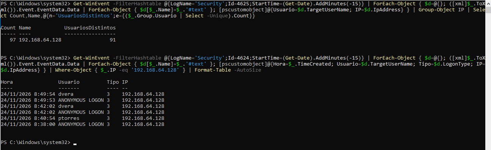

# 🌧️ Escenario 03 — Password Spraying

**MITRE ATT&CK:** T1110.003 · **Cuenta de ejemplo:** `dvera` (contraseña débil a propósito)

## 📝 Qué se probó
Desde Kali se enumeraron los usuarios del dominio (91) y se probó **una sola contraseña común** contra todos (herramienta NetExec, SMB). Un intento por cuenta evita alcanzar el umbral de bloqueo (5 intentos / 15 min), por eso el patrón es distinto al de la fuerza bruta clásica.

> Conexión con IAM: las contraseñas temporales fijas de las altas masivas ([`08-PowerShell`](../../08-PowerShell/)) son justo el tipo de valor que el spraying busca. Por eso la versión 2 del script genera una contraseña aleatoria por usuario.

## 🔍 Detección
La señal no es un usuario con muchos fallos, sino **una IP con fallos contra muchos usuarios distintos**:

- **4625** (fallo de logon, tipo 3), **4776** (validación NTLM) y **4771** (fallo de preautenticación Kerberos).
- **4624** tipo 3 posterior desde la misma IP: posible éxito del spray.

```powershell
Get-WinEvent -FilterHashtable @{LogName='Security';Id=4625;StartTime=(Get-Date).AddHours(-1)} |
  ForEach-Object { Get-EvData $_ } |
  Group-Object IpAddress |
  ForEach-Object { [pscustomobject]@{ Ip=$_.Name; Intentos=$_.Count; UsuariosDistintos=($_.Group.TargetUserName | Sort -Unique).Count } } |
  Where-Object { $_.UsuariosDistintos -ge 10 } | Sort UsuariosDistintos -Desc
```

**Regla sugerida para SOC L1:** ≥ 10 usuarios distintos fallando desde una misma IP en 10 minutos → escalar.

## 🛡️ Defensa
- Política de bloqueo (5 intentos / 15 min) y PSO para cuentas de servicio.
- Contraseñas no predecibles (sin patrones tipo `Estación+Año!`) y longitud mayor.
- Alerta por el patrón anterior (en el futuro, regla en Wazuh).

## ✅ Re-test
Tras restablecer la cuenta débil y aplicar las políticas, el spray no obtiene accesos válidos.

## 📸 Evidencias

**Spray con una sola contraseña contra todos los usuarios; un acierto [+] (contraseña difuminada)**

![Spray con una sola contraseña contra todos los usuarios; un acierto [+] (contraseña difuminada)](Evidencias/02-Spray-nxc.png)

**Detección: 97 fallos desde una IP contra 91 usuarios distintos, y logon tipo 3 posteriores**



> **Pendiente:** repetir el spray tras cambiar la contraseña débil y agregar la captura del resultado.
