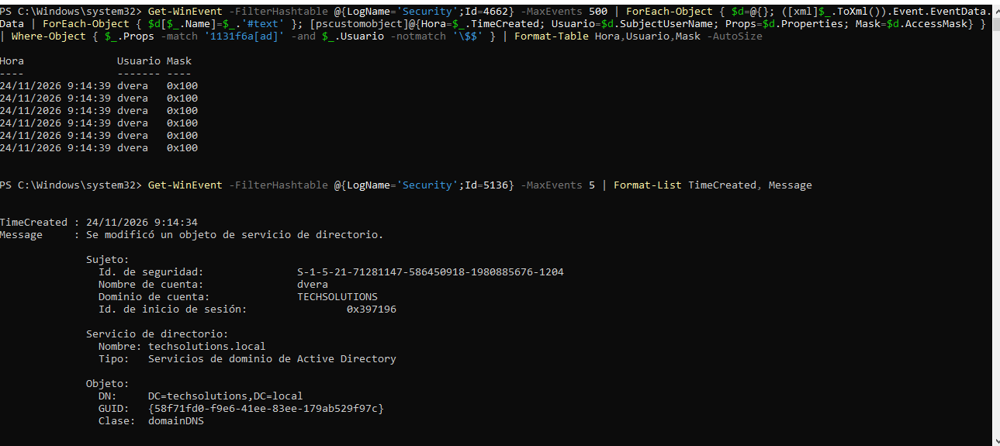
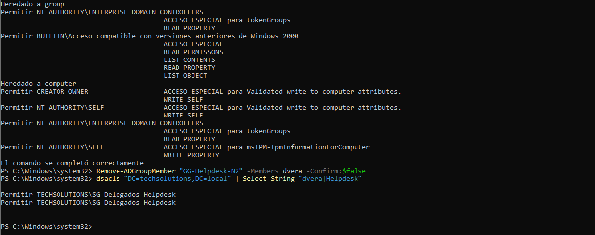
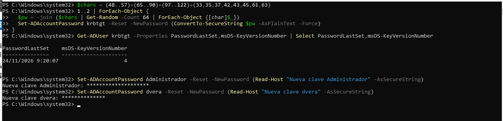

# 🧬 Escenario 04 — Abuso de ACL y DCSync

**MITRE ATT&CK:** T1222.001 (modificación de permisos) y T1003.006 (DCSync)

## 📝 Qué se probó
Se introdujo a propósito una **mala configuración**: un permiso excesivo (`WriteDacl`) para un grupo de Helpdesk sobre la raíz del dominio. Con ese permiso, una cuenta del grupo podía otorgarse derechos de replicación y pedir secretos al DC (DCSync). Se verificó que la cadena funcionaba y después se cerró.

## 🔍 Detección
1. **5136** — cambio de `nTSecurityDescriptor` en el objeto raíz del dominio (el permiso se modificó).
2. **4662** — acceso al directorio con los GUIDs de replicación (`1131f6aa-...` / `1131f6ad-...`) **desde una cuenta que no es de equipo (`$`)**.
3. **4624** tipo 3 desde una IP inusual.

Requiere la SACL en la raíz del dominio (ver [`06-Auditoria`](../../06-Auditoria/README.md)).

```powershell
Get-WinEvent -FilterHashtable @{LogName='Security';Id=4662} -MaxEvents 5000 |
  ForEach-Object { Get-EvData $_ } |
  Where-Object { $_.Properties -match '1131f6a[ad]-9c07-11d1-f79f-00c04fc2dcd2' -and $_.SubjectUserName -notlike '*$' } |
  Select TimeCreated, SubjectUserName, SubjectLogonId

Get-WinEvent -FilterHashtable @{LogName='Security';Id=5136} -MaxEvents 2000 |
  ForEach-Object { Get-EvData $_ } |
  Where-Object { $_.AttributeLDAPDisplayName -eq 'nTSecurityDescriptor' } |
  Select TimeCreated, SubjectUserName, ObjectDN
```

## 🛡️ Defensa aplicada
```powershell
dsacls "DC=techsolutions,DC=local" /R "TECHSOLUTIONS\GG-Helpdesk-N2"   # quitar ACL excesiva
Remove-ADGroupMember ...                                              # limpiar membresías indebidas
# krbtgt: doble reset (con espera entre ambos) por haberse expuesto sus secretos
```
La delegación legítima de Helpdesk (`SG_Delegados_Helpdesk`, ver [Caso 7](../../07-Casos-IAM/07-Delegacion-de-Permisos/)) se mantiene y se revalidó con la comprobación de acceso eficaz.

## ✅ Re-test
La replicación pedida desde la cuenta sin derechos falla. `krbtgt` muestra `msDS-KeyVersionNumber` incrementado (KVNO 4).

## 📸 Evidencias

**Evento 4662: accesos de replicación de dvera (cuenta que no es de equipo) y 5136 asociado**



**Remediación: queda solo la delegación legítima de Helpdesk**



**Reset de krbtgt: msDS-KeyVersionNumber = 4**



> **Pendiente:** captura del re-test (el intento de replicación fallando tras la remediación).
