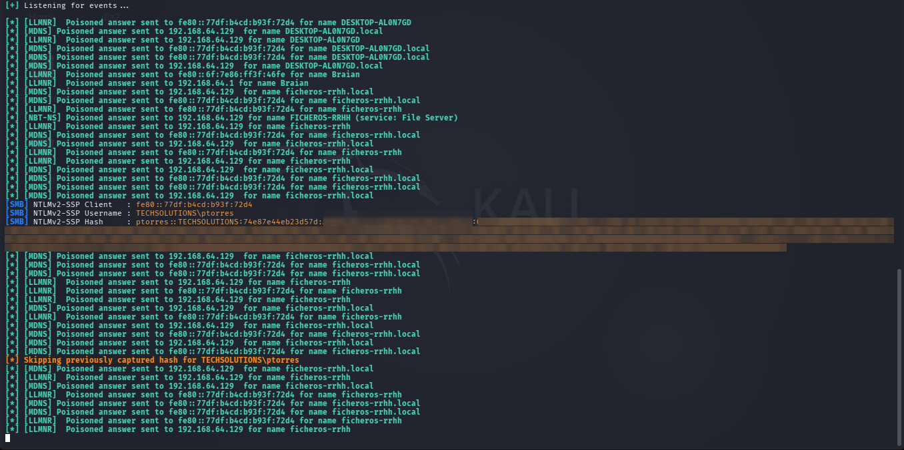
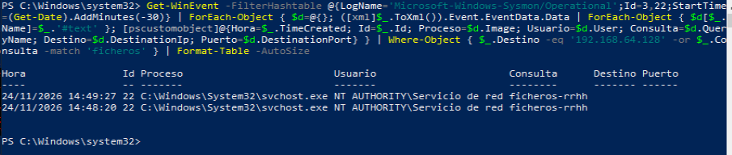
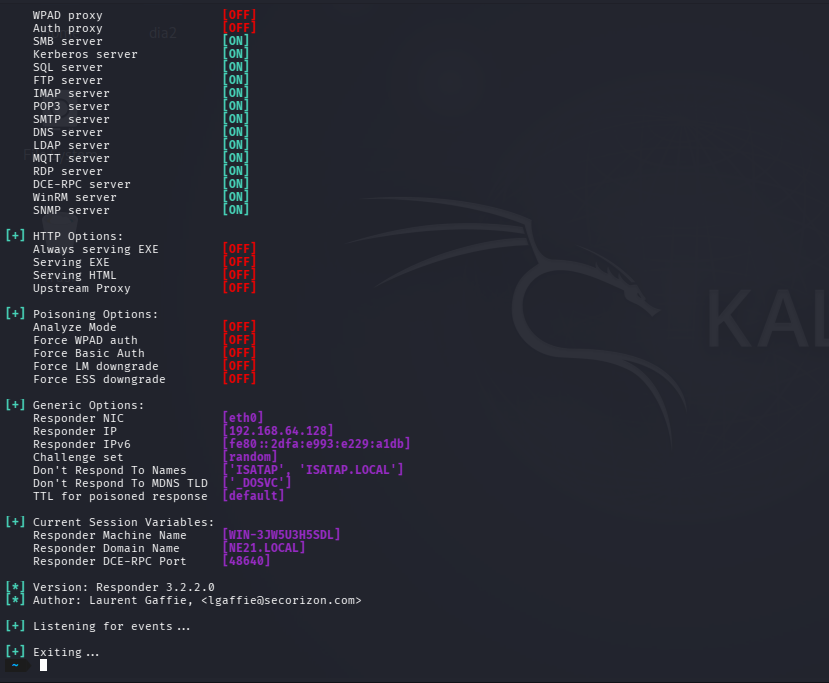

# 📡 Escenario 05 — LLMNR / NBT-NS Poisoning

**MITRE ATT&CK:** T1557.001 · **Cliente:** Windows 10 (usuario `ptorres`)

## 📝 Qué se probó
Cuando un equipo busca un nombre que el DNS no resuelve (por ejemplo un nombre mal tipeado), Windows recurre a LLMNR/NBT-NS, que cualquier host de la red puede contestar. Con Responder 3.2.2.0 en Kali se capturó un desafío NTLMv2 del usuario. Se intentó crackearlo offline (hashcat modo 5600).

## 🔍 Detección
Es el escenario más difícil de ver con telemetría de host:

- Sysmon **22** (consulta DNS) muestra el nombre inexistente que originó la cadena.
- Sysmon con SwiftOnSecurity **no ve** el tráfico LLMNR ni el SMB (lo maneja el proceso System). Es una limitación documentada.
- En el DC puede verse un **4624 tipo 3 / 4776** desde una IP inesperada.

```powershell
# En el cliente Windows 10
Get-WinEvent -FilterHashtable @{LogName='Microsoft-Windows-Sysmon/Operational';Id=22} -MaxEvents 500 |
  ForEach-Object { Get-EvData $_ } |
  Where-Object { $_.QueryStatus -ne '0' } |
  Select TimeCreated, Image, QueryName, QueryStatus
```

Como la detección es parcial, **la prevención es la defensa principal**.

## 🛡️ Defensa aplicada (GPO `SEC-Dominio-Hardening`)
```powershell
Set-GPRegistryValue -Name "SEC-Dominio-Hardening" -Key "HKLM\SOFTWARE\Policies\Microsoft\Windows NT\DNSClient" -ValueName EnableMulticast -Type DWord -Value 0
Set-GPRegistryValue -Name "SEC-Dominio-Hardening" -Key "HKLM\SYSTEM\CurrentControlSet\Services\Dnscache\Parameters" -ValueName EnableMDNS -Type DWord -Value 0
# + NetBIOS sobre TCP/IP deshabilitado
```
Además, `LmCompatibilityLevel 5` (solo NTLMv2).

## ✅ Re-test
Tras `gpupdate /force` y reinicio del cliente, el mismo nombre inexistente ya no genera respuesta LLMNR/NBT-NS y la herramienta no captura ningún hash.

## 📸 Evidencias

**Respuestas envenenadas LLMNR / mDNS / NBT-NS y captura del desafío NTLMv2 (hash difuminado)**



**Sysmon 22 en el cliente: consulta del nombre inexistente**



**Re-test: Responder escuchando, sin respuestas envenenadas ni capturas**



**Resultado de hashcat sobre los hashes de `ptorres`: ninguna contraseña recuperada** (`--show` no devuelve nada, con rockyou y la regla de variaciones).


