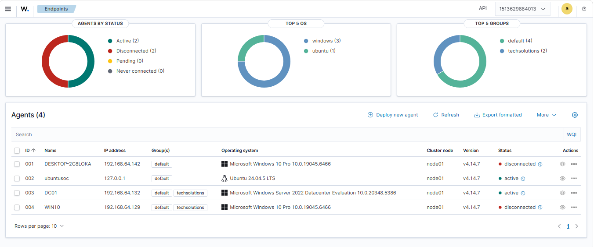
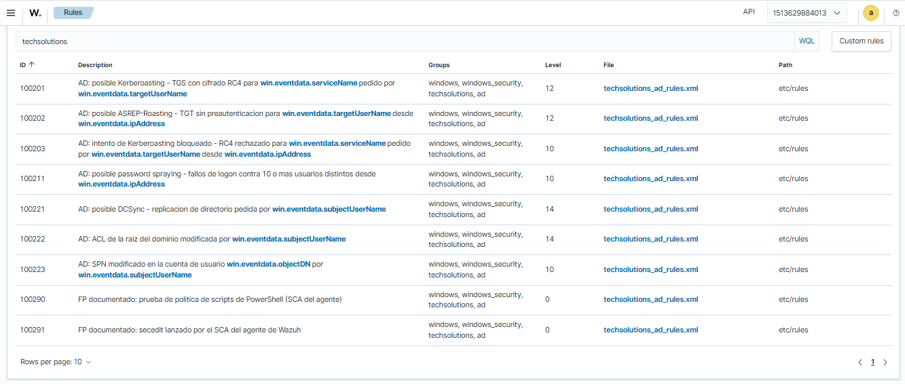
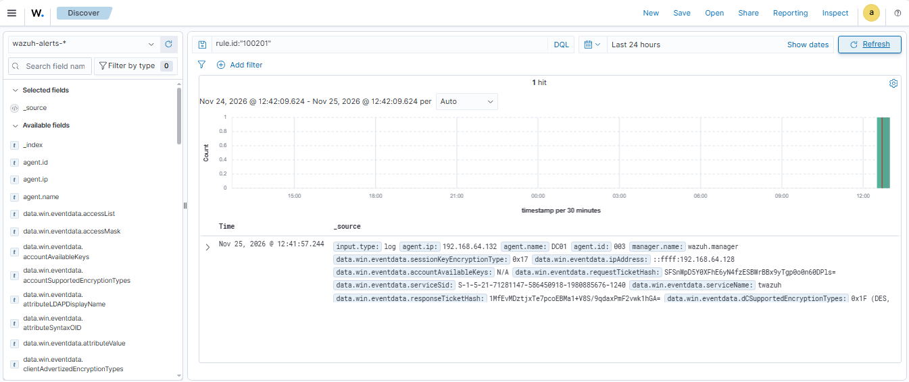
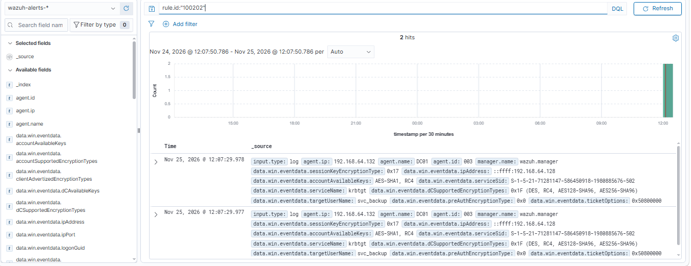
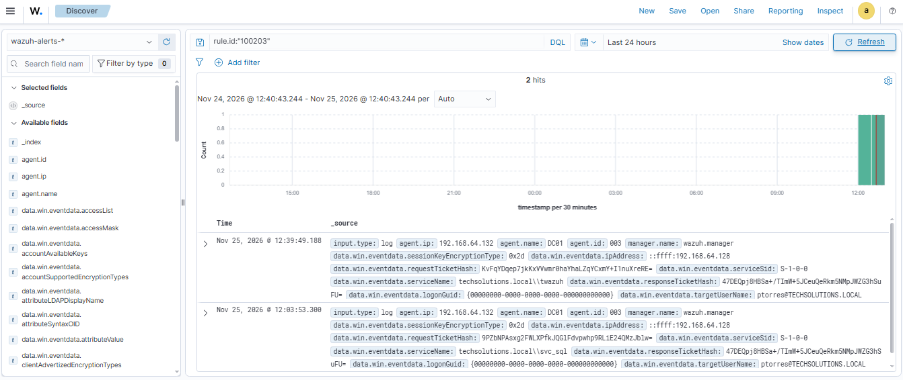
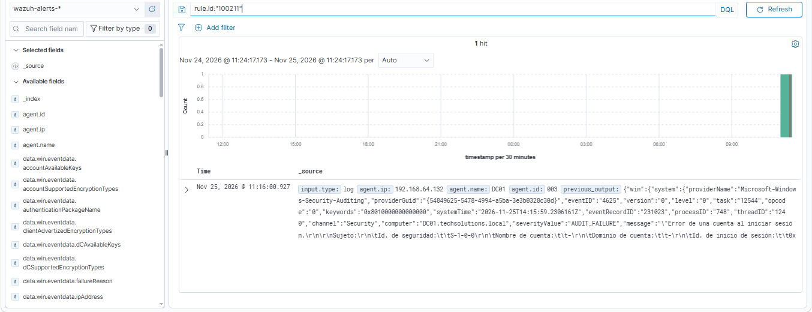
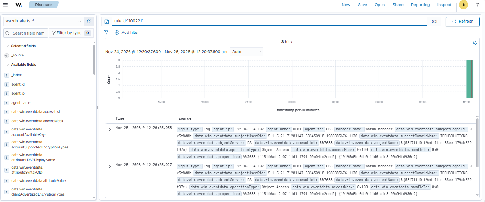
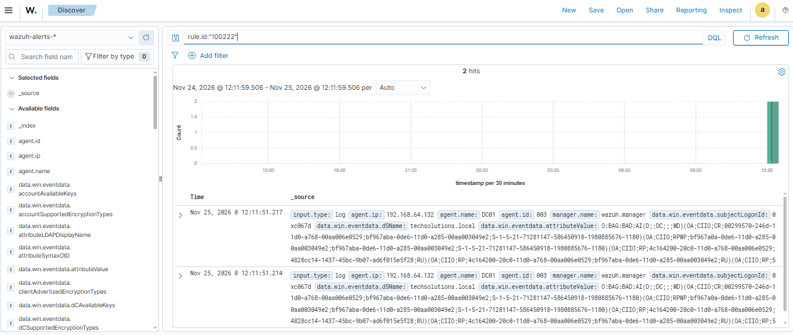
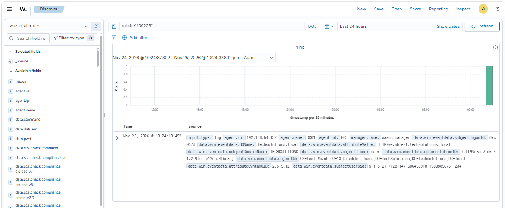

# 🛰️ 13 — SIEM con Wazuh: detección automática de los ataques a AD

En la carpeta [`12-Ataque-y-Deteccion`](../12-Ataque-y-Deteccion/) los ataques se detectaban **a mano**, con el Visor de eventos y `Get-WinEvent`. Acá se automatiza: el Security log y Sysmon del DC se envían a **Wazuh** y un conjunto de **reglas propias** (IDs `100200–100299`) genera la alerta, ya mapeada a MITRE ATT&CK.

El criterio de aceptación fue estricto: una regla solo se considera lista si **dispara cuando se repite el ataque real desde Kali** (y, donde aplica, si *no* dispara con tráfico parecido pero legítimo).

## 🧭 Arquitectura

```text
 Kali (192.168.64.128)         DC01 (192.168.64.132)            ubuntusoc (192.168.64.10)
 impacket / NetExec  ──────►   Security log + Sysmon   ──────►  Wazuh manager + indexer + dashboard
 ataques de la carpeta 12      agente Wazuh (grupo             (Docker, v4.14.7)
                               "techsolutions")                reglas 100201–100291
 WIN10 (192.168.64.129): agente + Sysmon enrolados (apagada durante las pruebas)
```

| Componente | Detalle |
|---|---|
| Manager / indexer / dashboard | Wazuh 4.14.7 en Docker, sobre Ubuntu Server 24.04 (`ubuntusoc`) |
| Agentes | DC01 (003) y WIN10 (004), versión 4.14.7, grupo `techsolutions` |
| Canales recolectados | `Security` y `Microsoft-Windows-Sysmon/Operational` (eventchannel) |
| Reglas propias | [`reglas/techsolutions_ad_rules.xml`](reglas/techsolutions_ad_rules.xml): 7 de detección + 2 de afinado |

> Los IDs `100200–100299` se eligieron a propósito para no pisar los de mi otro laboratorio, [Threat-Hunting-Detection-Lab](https://github.com/braianffernandez096-bripto/Threat-Hunting-Detection-Lab) (`100020–100110`).

## 🧪 Reglas y resultado de la validación

| Regla | Qué detecta | Nivel | MITRE | Evento / campos clave | Estado |
|---|---|---|---|---|---|
| `100201` | Kerberoasting **exitoso** (TGS con RC4) | 12 | T1558.003 | 4769, `ticketEncryptionType=0x17`, `status=0x0`, servicio que no es `krbtgt` ni cuenta de equipo | ✅ validada |
| `100202` | AS-REP Roasting (TGT sin preautenticación) | 12 | T1558.004 | 4768, `preAuthType=0`, `status=0x0`, cuenta que no es de equipo | ✅ validada |
| `100203` | Kerberoasting **bloqueado** por el hardening | 10 | T1558.003 | 4769 fallido, `ticketEncryptionType=0xffffffff`, `status=0xe` | ✅ validada con 2 cuentas |
| `100211` | Password spraying | 10 | T1110.003 | ≥10 usuarios distintos en 120 s desde una misma IP (sobre 4625 / regla 60122) | ✅ positiva y negativa |
| `100221` | DCSync | 14 | T1003.006 | 4662 con GUIDs `1131f6aa` / `1131f6ad` pedidos por una cuenta que no es de equipo | ✅ validada |
| `100222` | ACL de la raíz del dominio modificada | 14 | T1222.001 | 5136 sobre `nTSecurityDescriptor` de `DC=techsolutions,DC=local` | ✅ validada |
| `100223` | SPN agregado/modificado en una cuenta de usuario | 10 | T1558.003 | 5136 sobre `servicePrincipalName`, clase `user` | ✅ validada |
| `100290` | Silenciador: prueba de política de scripts del SCA del agente | 0 | — | 92205 + `__PSScriptPolicyTest_*.ps1` en `SystemTemp` | ⚠️ validada contra el evento real de la primera tanda; no se repitió en vivo |
| `100291` | Silenciador: `secedit` lanzado por el SCA del agente | 0 | — | 92066 + directorio del agente + `secedit /export /cfg …` | ✅ validada (20 `secedit`, 0 alertas) |

### Cómo se reprodujo cada ataque

| Regla | Prueba (desde Kali) | Preparación y reversión en DC01 |
|---|---|---|
| `100201` | `impacket-GetUserSPNs … -request-user <cuenta>` | Cuenta de prueba con SPN y RC4 habilitado de forma explícita (`msDS-SupportedEncryptionTypes = 4`); luego se deshabilita, se quita el SPN y se borra |
| `100202` | `impacket-GetNPUsers … -no-pass` | Se encontró el flag `DoesNotRequirePreAuth` activo en `svc_backup` (ver [hallazgos](#-hallazgos-de-la-validación)) y se revirtió al terminar |
| `100203` | Mismo `GetUserSPNs` contra `svc_sql` (AES-only) y contra una cuenta nueva | Ninguna: es el estado endurecido |
| `100211` | NetExec/SMB con 10 usuarios inexistentes y una contraseña | Ninguna |
| `100211` (negativa) | NetExec/SMB con 12 contraseñas contra **un solo** usuario | La regla **no** debe saltar, y no saltó |
| `100221` | `impacket-secretsdump -just-dc-user <cuenta>` con `ptorres` | Se le concedió temporalmente `Replicating Directory Changes` y `… All` sobre la raíz del dominio; se revirtió y se verificó `0` ACEs |
| `100222` | La propia concesión anterior (`Set-Acl` sobre la raíz) | Idem |
| `100223` | `Set-ADUser … -ServicePrincipalNames @{Add=…}` | Se quitó el SPN al terminar |

## 📸 Evidencias

Cada captura es una búsqueda en Discover (`rule.id:"…"`) sobre `wazuh-alerts-*`, hecha **después** de repetir el ataque desde Kali.

**Agentes** — DC01 y WIN10 en el grupo `techsolutions`, todos en la misma versión (4.14.7) que el manager. WIN10 figura desconectada porque la VM estaba apagada. El agente 001 es anterior a este laboratorio y no se tocó.



**Reglas cargadas** — las 9 reglas del archivo `techsolutions_ad_rules.xml`, con su nivel.



**`100201` — Kerberoasting exitoso (RC4)**



**`100202` — AS-REP Roasting** (dos alertas: impacket envía el pedido dos veces, con 3 ms de diferencia)



**`100203` — Kerberoasting bloqueado** (la misma regla con dos cuentas distintas: `svc_sql` y la cuenta de prueba)



**`100211` — Password spraying** (un solo hit; la prueba negativa de muchos intentos contra un único usuario no la dispara)



**`100221` — DCSync** (tres alertas: dos con `1131f6aa` y una con `1131f6ad`)



**`100222` — ACL de la raíz del dominio** (dos alertas: "valor eliminado" + "valor agregado")



**`100223` — SPN agregado a una cuenta de usuario**



## 🔎 Hallazgos de la validación

Repetir los ataques contra el dominio ya endurecido dejó cosas que no se veían leyendo la documentación:

1. **`svc_backup` tenía `DoesNotRequirePreAuth` activo** cuando empecé la prueba de AS-REP, aunque el [escenario 02](../12-Ataque-y-Deteccion/02-ASREP-Roasting/) documenta que se había quitado. Se corrigió en el momento (`Set-ADAccountControl svc_backup -DoesNotRequirePreAuth $false`) y se verificó. Lección: validar detecciones también sirve para **auditar el hardening**, y conviene incluir esa consulta en cada re-auditoría.
2. **El dominio ya no entrega tickets RC4 por defecto.** El Kerberoasting contra una cuenta nueva terminó en `KDC_ERR_ETYPE_NOSUPP`. Solo tuvo éxito cuando le habilité RC4 a la cuenta de prueba de forma explícita. Por eso existen dos reglas: la `100201` (éxito, el caso grave) y la `100203` (intento bloqueado, que sigue siendo un indicador de reconocimiento).
3. **El hash AS-REP salió con AES256** (`ticketEncryptionType 0x12`) aunque el cliente solo pidió RC4: la cuenta es AES-only, lo que encarece el cracking. La detección salta igual.
4. **Una regla de afinado mal escrita deja pasar el ruido.** La primera versión de `100291` buscaba `secexport.cfg`, pero el SCA usa `secpol.cfg` en cada chequeo. Se detectó al repetir el escaneo y se corrigió. Detalle en [`triaje-falsos-positivos.md`](triaje-falsos-positivos.md).

## ⚠️ Limitaciones y decisiones de diseño

- **No hay `wazuh-logtest` para eventos de Windows**: el decodificador `eventchannel` es interno. Por eso cada regla se validó con el ataque real.
- **El 4768 no genera alerta por defecto** en Wazuh; la `100202` es la que lo hace visible.
- **`100211` usa 120 s**, más estricta que la ventana de 10 minutos que sugería el escenario 03. Una ventana más larga captura spraying lento ("low and slow") a costa de más falsos positivos; queda como ajuste.
- **`100222` genera dos alertas por cada cambio**, porque AD registra la ACL como "valor eliminado" + "valor agregado". Es ruido menor; una mejora posible es limitarla a `operationType = %%14674`.
- **`100203` puede dar falsos positivos** con clientes viejos que pidan un cifrado que una cuenta AES-only no soporta; por eso es de nivel 10 y no 12.
- **`100211` es de frecuencia**: depende de que la regla padre `60122` (4625 con usuario inexistente o contraseña incorrecta) sea la que clasifique el evento.
- **WIN10 estuvo apagada** durante las pruebas: sus agentes están enrolados y con Sysmon, pero la validación se hizo sobre DC01.

## 🛠️ Despliegue de las reglas (Wazuh en Docker)

```bash
# 1) copiar al contenedor del manager y fijar permisos
sudo docker cp techsolutions_ad_rules.xml single-node-wazuh.manager-1:/var/ossec/etc/rules/
sudo docker exec single-node-wazuh.manager-1 bash -c \
  "chown wazuh:wazuh /var/ossec/etc/rules/techsolutions_ad_rules.xml; chmod 660 /var/ossec/etc/rules/techsolutions_ad_rules.xml"
# 2) validar sintaxis (silencio = OK)
sudo docker exec single-node-wazuh.manager-1 /var/ossec/bin/wazuh-analysisd -t
# 3) reiniciar y comprobar que los agentes vuelven a Active
sudo docker exec single-node-wazuh.manager-1 /var/ossec/bin/wazuh-control restart
sudo docker exec single-node-wazuh.manager-1 /var/ossec/bin/agent_control -l
```

Más detalle operativo (reinicios, versiones de agente, horarios) en [`notas-operativas.md`](notas-operativas.md).

## 📌 Pendientes

- Revisar `Null Auth: True` que NetExec reportó en DC01, antes de la re-auditoría final con PingCastle.
- Repetir la validación con WIN10 encendida (Sysmon del endpoint).
- Notificaciones por correo para las alertas de nivel ≥ 12 (hoy figuran con `mail: true` pero no hay SMTP configurado).
- Dashboards propios para el SOC L1 y runbook de respuesta por regla.

> 🔒 Laboratorio aislado con fines educativos. Las cuentas y configuraciones débiles que aparecen se crearon a propósito y ya fueron remediadas o eliminadas. Las capturas tienen difuminados los hashes y las contraseñas.
